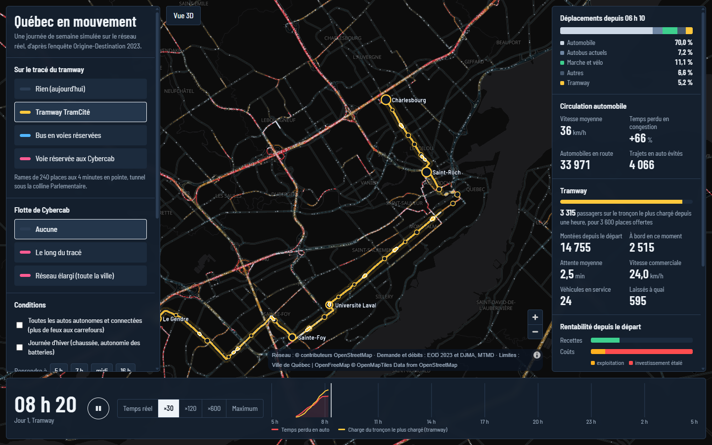
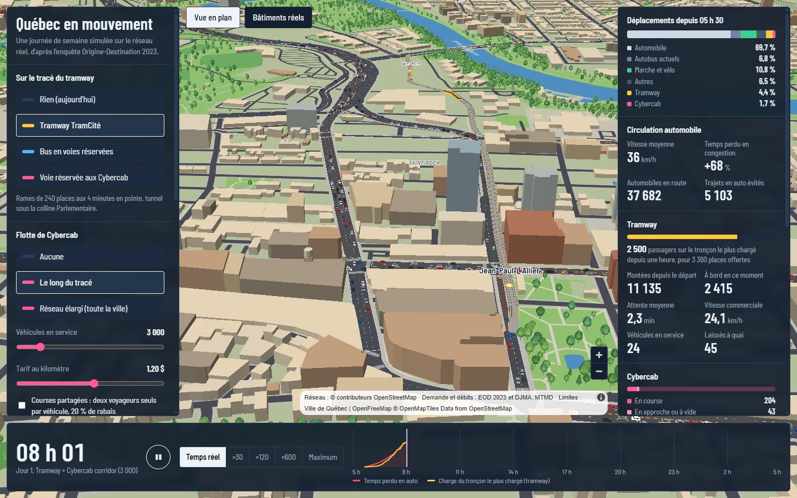

# Québec en mouvement

<p align="center">
  
</p>

<p align="center">
  <a href="https://toonight.github.io/quebec-en-mouvement/"></a>
</p>

<p align="center">
  <a href="https://github.com/toonight/quebec-en-mouvement/actions/workflows/pages.yml"></a>
  
  
  
  
</p>

Simulateur citoyen du transport à Québec. Une journée de semaine est rejouée sur le réseau
routier réel, et vous choisissez ce qui roule sur le tracé du tramway. Le simulateur montre
la circulation, l'achalandage, la rentabilité pour l'exploitant et le bilan pour la société.

> [!IMPORTANT]
> **Ce n'est pas une étude officielle.** C'est un projet citoyen indépendant, sans lien avec
> la Ville de Québec, CDPQ Infra, le RTC ou Tesla. Le modèle est calé sur des données
> publiques et sert à comparer des ordres de grandeur. Toutes les hypothèses sont affichées
> dans l'application (« Hypothèses et sources ») et se modifient dans
> `web/js/engine/core.js` et `web/js/engine/econ.js`.

## 🚋 Quatre choix pour le même tracé

Un seul type de véhicule roule sur la voie réservée. Chaque mode garde sa couleur partout
dans l'application.

| | Sur le tracé | Ce qui est simulé |
|---|---|---|
|  | Tramway TramCité | Rames de 240 places aux 4 minutes en pointe, tunnel sous la colline Parlementaire |
|  | Bus en voies réservées | Bus articulés de 105 places aux 2 min 30 en pointe, en surface sur tout le trajet |
|  | Voie réservée aux Cybercab | Robotaxis à deux places qui gardent la voie pour eux seuls |
|  | Rien (aujourd'hui) | La situation de référence, calée sur les comptages |

La flotte de Cybercab peut aussi desservir toute la ville, avec des courses partagées et une
part de résidents qui renoncent à leur auto.

## 🗺️ Aperçu

| Vue en plan : la pointe du matin avec le tramway | Vue 3D : Saint-Roch, tramway et Cybercab |
|---|---|
|  |  |

## 🚀 Lancer

Il faut [Node.js](https://nodejs.org) 20 ou plus récent.

```powershell
node scripts/serve.js
```

Puis ouvrir http://localhost:5173. Les bibliothèques et les polices sont dans le dépôt ;
seul le fond de carte (OpenFreeMap) demande une connexion Internet.

Le dossier `web/` est un site statique : il se publie tel quel, par exemple sur GitHub Pages
(le flux `.github/workflows/pages.yml` le fait à chaque envoi sur `main`).

## 🎛️ Utiliser

- **Scénario** : mode sur le tracé (un seul type de véhicule par voie), zone et taille de la
  flotte de Cybercab, tarif, courses partagées, résidents sans auto, journée d'hiver,
  parc d'autos entièrement autonome et connecté (plus de feux aux carrefours).
- **Autos autonomes et connectées** : supposition extrême où tout le parc est remplacé par des
  autos électriques qui se coordonnent. Le coût de ce remplacement n'est pas compté.
- **Vue 3D** : la ville en volume, rues avec trottoirs, marquages, passages piétons, rails du
  tramway et arbres des parcs, avec chaque véhicule dessiné sur sa voie. Chaque auto se suit du départ à
  l'arrivée : elle garde sa couleur et sa voie et tourne aux carrefours. La vue 3D ramène la vitesse au temps réel.
  Un véhicule du moteur représente environ quatre autos réelles ; en vue 3D, elles sont toutes dessinées.
- **Bâtiments réels** (facultatif) : en vue 3D, la ville photographiée en 3D par Google remplace les volumes
  dessinés. Il faut une clé d'API Google Maps Platform personnelle (« Map Tiles API », facturation à votre
  nom) ; elle reste dans le navigateur, n'est envoyée qu'à Google et n'est jamais écrite dans ce dépôt.
- **Temps** : pause, vitesse (du temps réel au maximum), reprise à 5 h, 7 h, midi ou 16 h.
- **Comparer les journées simulées** : chaque journée complète s'ajoute à deux tableaux,
  déplacements et rentabilité. Deux boutons simulent d'un coup la journée du scénario, ou quatre scénarios types.
- **Hypothèses de coûts** : cinq curseurs recalculent la rentabilité sans relancer la journée.
- **Copier le lien de ce scénario** : l'adresse contient le scénario et les coûts choisis.

## 📊 Ce que le modèle reproduit

| Mesure | Simulé | Observé ou officiel |
|---|---|---|
| Débit journalier sur 109 sections de comptage | 1,1 fois le débit mesuré (médiane) | Comptages DJMA du ministère des Transports |
| Temps perdu en congestion, journée | +39 % | +41 % (TomTom) |
| Temps perdu, pointe du matin et du soir | +58 % et +71 % | +55 % et +77 % (TomTom) |
| Tramway, déplacements par jour | environ 73 400 | 73 000 (prévision de CDPQ Infra, horizon 2041) |
| Tramway, charge du tronçon le plus chargé | environ 3 600 passagers par heure | 3 200 à 3 500 (étude de 2022) |

## ⚠️ Limites

- La demande totale est fixe : un nouveau service n'induit pas de déplacements.
- Pas de feux simulés un à un ni de files d'attente physiques : la congestion est estimée par tronçon.
- Le réseau d'autobus actuel du RTC n'est pas animé et son service ne s'ajuste pas.
- Les coûts des Cybercab suivent les cibles de Tesla, qui ne sont pas démontrées en
  exploitation. Aucun robotaxi n'est autorisé au Québec hors projet pilote.
- Les coûts d'exploitation du tramway et l'investissement du bus en voies réservées sont des
  hypothèses, faute de chiffres officiels pour ce tracé.
- Les limites de Lévis et de la ceinture nord sont approximées.

## 🛠️ Développer

```powershell
node --test tests/engine.test.js
node tests/run_day.js tram off 0 24
node tests/calib.js tram
node tests/econ_report.js
node tests/make_reference.js
```

- `run_day.js <none|tram|bus> <off|corridor|wide> <flotte> <heures>` : une journée hors
  navigateur, avec le bilan complet.
- `calib.js` : congestion par période, débits DJMA et achalandage, pour vérifier le calage.
- `econ_report.js` : rentabilité annuelle de huit scénarios (environ 3 minutes).
- `cab_study.js <flotte> <tarif au km> [forfait] [none|tram|bus|cablane] [off|corridor|wide]` :
  autos retirées, provenance des passagers et congestion. `HOURLY=1` ajoute le détail par
  heure, `POOL=1` les courses partagées, `CARFREE=0.1` dix pour cent de résidents sans auto.
- `make_reference.js` : régénère `web/js/engine/reference.js`, la journée de référence qui
  sert au calcul du temps des automobilistes. À relancer après tout changement du moteur.

Pour reconstruire les données à partir des sources (Python 3) :

```powershell
python scripts/fetch_raw.py
python scripts/build_data.py
```

`fetch_raw.py` télécharge une fois les données publiques dans `data/raw/` ; `build_data.py`
produit `data/network.json` (lisible) et `web/data/network.js` (la même chose sous forme compacte,
décodée au chargement). `python scripts/build_data.py --web` refait seulement le second à partir du premier.

### Organisation

- `web/js/engine/` : le moteur, sans dépendance, utilisable sous Node.
  `core.js` (paramètres), `network.js` (rues, congestion, itinéraires), `line.js` (tramway ou
  bus), `cabs.js` (flotte), `sim.js` (demande et choix modal), `econ.js` (rentabilité).
- `web/js/app.js` : la carte et l'interface. `web/js/assumptions.js` : hypothèses affichées.
- `scripts/` : construction des données et serveur local. `tests/` : tests et outils de calage.

### Modèle en bref

- Demande : matrices de l'Enquête Origine-Destination 2023 Québec-Lévis (12 grands secteurs,
  4 périodes), 1 agent pour 5 personnes.
- Circulation : graphe OpenStreetMap des autoroutes aux collectrices, temps par tronçon selon
  la charge, itinéraires recalculés selon la congestion.
- Ligne structurante : véhicules, arrêts, capacité et files d'attente simulés un par un.
- Cybercab : véhicule libre le plus proche, courses partagées, trajets à vide, odomètre,
  recharge ; voie réservée le long du tracé avec ses propres temps de parcours et itinéraires.
- Choix modal : report par logit binaire depuis le mode de référence de l'enquête.

## 📄 Licences

Code sous licence MIT (`LICENSE`). Données, bibliothèques et polices : voir `DONNEES.md`.
Réseau routier © contributeurs OpenStreetMap (ODbL).
